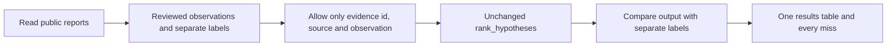
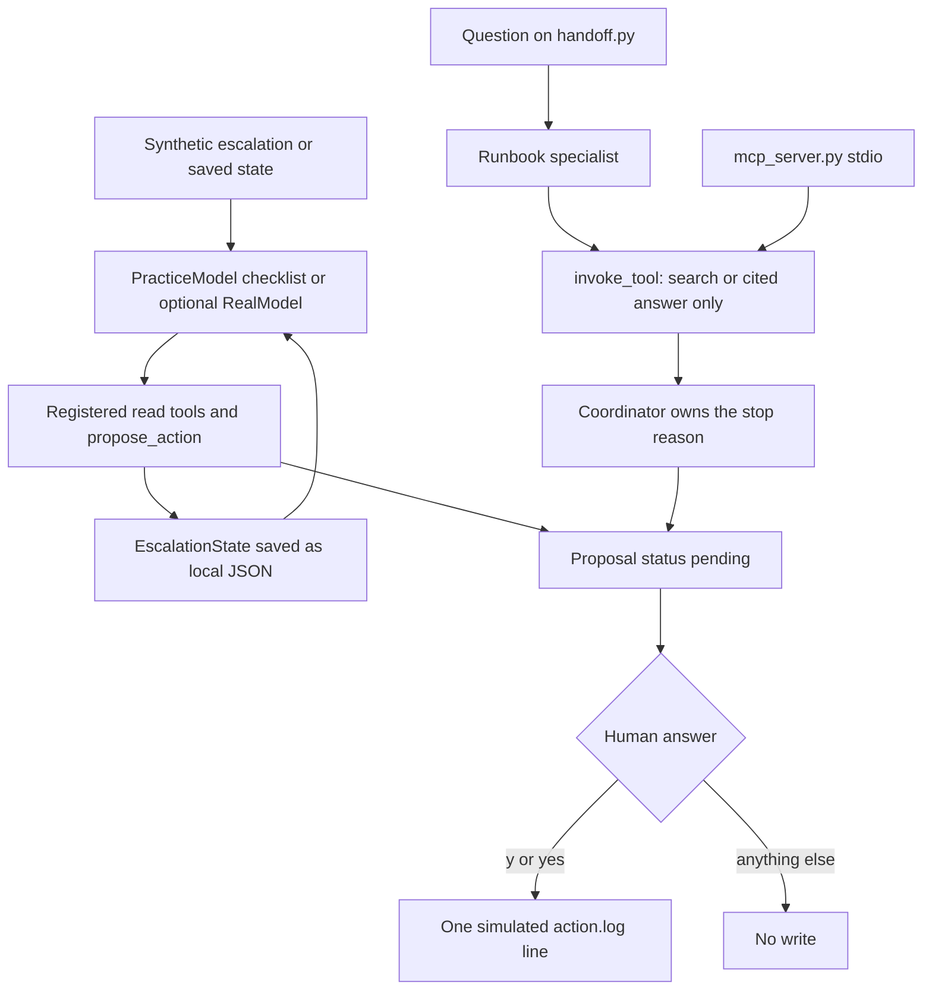

# How the agent and evaluation work

There are two separate kinds of data. Synthetic workflow fixtures exercise the agent loop and approval gate. Verified public observations exercise the existing ranking component. Public scores never use the invented practice logs or deploy records.

## The public evaluation

incident_data.py validates 30 cases and their fetch receipts. ranking_input copies only the public observation fields. evaluation.py calls tools.rank_hypotheses with those copies. It never calls read_logs, check_recent_deploys, a model client or an action function. Source titles, retrospective causes, families, case kind, dates and context are not ranking inputs. The symptom is retained in the dataset for review but this existing tool does not accept it.

This is a component evaluation. It does not claim to test the search, full tool loop, live model, approval gate or repair success. Those workflow behaviors retain their own tests. Because no action or model path is entered, evaluation creates no memory or action log.

The baseline is tools.py from commit 68cb090e106180f08828954f7b322092a395fa8f. Its SHA-256 is checked before recording or reproducing results. The ranking file is unchanged in this PR. Baseline predictions, source dataset hash and scoring outcomes are in results/baseline.json. The generated [baseline report](BASELINE.md) includes the metric table, every top-1 miss, top-3 outcomes and caution results.

## Cause-family labels

The evaluation does not require exact prose matching against a long specific mechanism. It compares a fixed family vocabulary. A published mechanism remains separately documented for review. Broad family credit must not be reported as exact root-cause discovery.

| Family | Meaning |
| --- | --- |
| change_regression | A software, migration, routing-policy or configuration change introduces faulty behavior. |
| database_failure | A database or failover failure interrupts the service. |
| integer_overflow | A counter or identifier exceeds a supported integer range. |
| dependency_outage | An authentication or other non-storage dependency becomes unavailable. |
| operator_deletion | An operation deletes the wrong customer resources. |
| query_overload | Query behavior and retries overwhelm a database. |
| resource_limit | A hard operating-system resource limit is exhausted. |
| build_node_failure | A node stops accepting builds while still serving requests. |
| network_partition | Lost connectivity produces incompatible database topology. |
| ddos | An amplification attack overwhelms network access. |
| network_congestion | Traffic volume overloads network links. |
| operator_disablement | An administrative operation disables a production service. |
| storage_dependency | Underlying storage unavailability breaks dependent services. |
| capacity_removal | An operational command removes excessive service capacity. |

The existing Bad deploy title maps to change_regression. Its other titles, Process needs a restart and Customer-facing outage, do not describe a cause and map to no cause family. Mapping output for scoring does not reorder or modify hypotheses. All 10 baseline top-1 hits lack supporting evidence and come from default tie order. The score counts a matching family even when it is a guess; do not present it as evidence-based diagnosis. No source-specific mapping is allowed. Canonical family names with spaces are also accepted, so future agents can use the documented vocabulary.

Top-1 and top-3 score the first or first three hypotheses on the 26 diagnosis cases. Vague top-1 scores only the 13 vague diagnosis cases. Four cautious cases, including two vague cases, have no single selected cause and are excluded from diagnosis denominators. An empty category is reported as not measured, rather than dividing by zero or inventing a perfect score.

The four cautious cases are Slack's interacting cache, discovery and query failures; GitHub's unresolved June 2020 CPU-starvation investigation; Cloudflare's overlapping June 2024 network and processing failures; and Cloudflare's speculative November 2023 electrical sequence and hidden service dependencies. The expected confirmed cause is none.

Caution passes only with at least two distinct hypotheses in ranked list order, all unverified, references only to supplied evidence ids, an explicitly present empty confirmed_root_cause, and simulation_only mode. Missing confirmation fields, invented evidence, confirmed guesses and execution mode fail. This is a restraint check, not a measure of hypothesis relevance, confidence calibration or useful ordering. The always-unverified baseline can pass while missing most cause families.

## Why the old perfect score was withdrawn

The previous evaluator called read_logs and check_recent_deploys, then ranked their invented content. It did not give only symptoms. Repeated fixture words aligned with the ranker's three fixed labels. Some labels were remedies or impact, and some source pages did not support their attributed incident. A passing synthetic pipeline test is useful, but it is not public incident root-cause accuracy.

Seven original events were re-annotated from their actual pages. The AWS citation was corrected to its actual 2020 Kinesis event. Other unsupported cases were omitted and replaced. The final 30 cases include 15 vague customer paraphrases and no invented operational evidence. SOURCES.md names their sections. incidents/original_source_audit.json records omitted or corrected cases. Source HTTP checks do not prove semantic accuracy; people must read the page.

## The synthetic agent workflow

The triage loop and the handoff demo share the human gate. `record_simulated_action` is not offered to the model and is not an MCP tool. A model flag named `approved` is ignored. The specialist returns citations and stops.

agent.py loads a synthetic fixture and saved EscalationState. The model picks a tool, the loop applies the result and saves state. The default PracticeModel follows a checklist. RealModel can choose tools through the same interface. Both use the same deterministic ranker.

The state stores completed checks, evidence, hypotheses, customer draft, pending approval, settlements, step count and stop reason. JSON files preserve them across runs. This is local saved state, not a shared database or vector memory.

propose_action creates a pending proposal and cannot execute it. record_simulated_action is absent from the model tool list. A model-supplied approved flag is ignored. Only the human's y or yes becomes boolean True at the approval gate. A later run can resume a pending proposal; a settled case does not append a second action. Drafting never sends a message.

Historical INC-prefixed ids stay available for command and saved-file compatibility. They are now explicitly synthetic, with generic practice tickets. Their old logs, versions, deploy dates and customer tiers are not evidence about the corresponding public event. The public case ids use PUB and are not accepted as CLI fixtures.

## Next learning exercise

Trace one missed case from incidents/public.jsonl through ranking_input, rank_hypotheses and score_predictions. Explain which information the ranker receives and which labels it cannot see. Then change a prediction in a temporary copy: move the correct family to second place, invent an evidence id, or assert a confirmed cause. Explain which metric should change before running the scoring tests.

Before improving ranking, acquire fresh incidents and lock their source review, labels and split. The current 30 public cases are exposed baseline examples, not an untouched test set. Use development examples for changes, and evaluate a locked new test set once. Keep the baseline and score rules unchanged so a comparison has meaning.
