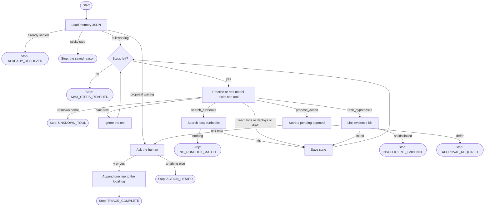

# How the escalation agent works

This page is for someone new to the code. Read it with `agent.py` open.

The agent handles one support escalation built from real public incident write-ups. It walks a checklist of tools. It keeps what it learned in a state object. It saves that object to a JSON file after every step. When it wants to restart, roll back, or page someone, it stops and asks a human. Only `y` or `yes` lets a simulated line get appended to a local log.

## Real Public Data & Limitations

The repository uses real public incident post-mortems (such as Cloudflare, GitHub, AWS, Slack, Datadog, Fastly, Atlassian, Google Cloud, Reddit, OpenAI, Heroku) and public troubleshooting runbooks. All URLs in `SOURCES.md` return HTTP 200.

Where raw log files or deploy logs were not provided in the original public post-mortems, log lines and deploy histories are reconstructed from the facts stated in those post-mortems and clearly labeled as `(reconstructed from public write-up)`.

## Limits

The evaluation score is calculated against a small hand-built set of 12 real incident post-mortems. It serves as a regression check for the practice pipeline rather than an exhaustive benchmark of real-world production incident response.

## The picture

Follow one arrow at a time. The sample ticket `INC-CLOUDFLARE-01` takes the long path: search, logs, deploys, rank, draft, propose, then the human question.

## Offline Incident Evaluation

`evaluation.py` evaluates all 12 real incident write-ups. It feeds the agent only the ticket description (rewritten directly from published post-mortem summaries) and checks if the top-ranked hypothesis matches the published root cause from the post-mortem.

## The state is the memory

`EscalationState` in `state.py` is a small object with:

- `checked` — whether runbooks, logs, and deploys have been read
- `evidence` — the rows collected so far
- `hypotheses` — the ranked list, with evidence ids
- `customer_draft` — the unsent text
- `pending_approval` — the proposal, or empty
- `settlements` — what the human decided
- `step_log` — short lines you can read in the JSON
- `steps_used` — how many model calls this escalation has spent

`save_state` writes `memory/<escalation id>.json` after a step. One file holds one escalation.

## The approval boolean

`propose_action` never runs anything. It is not even able to write the log. The function that writes the log is `record_simulated_action`, and it is not in the tool list the model can call.

`record_simulated_action` writes a line only when `approved is True`. In Python, `True` is a boolean. The string `"yes"`, the string `"true"`, and the string `"approved"` are not that boolean, so they do not write a line.

`human_said_yes` is the only function that turns a typed answer into that boolean, and only for `y` or `yes`.

## Live Model (--real)

`RealModel` in `agent.py` supports `--real` using `grok-build-0.1`. It reads `XAI_API_KEY` from the environment without printing or storing it. In tests, a fake client stands in for the live xAI client so no API key or network is needed. The live model path was tested only with this offline fake client and was not executed live.
