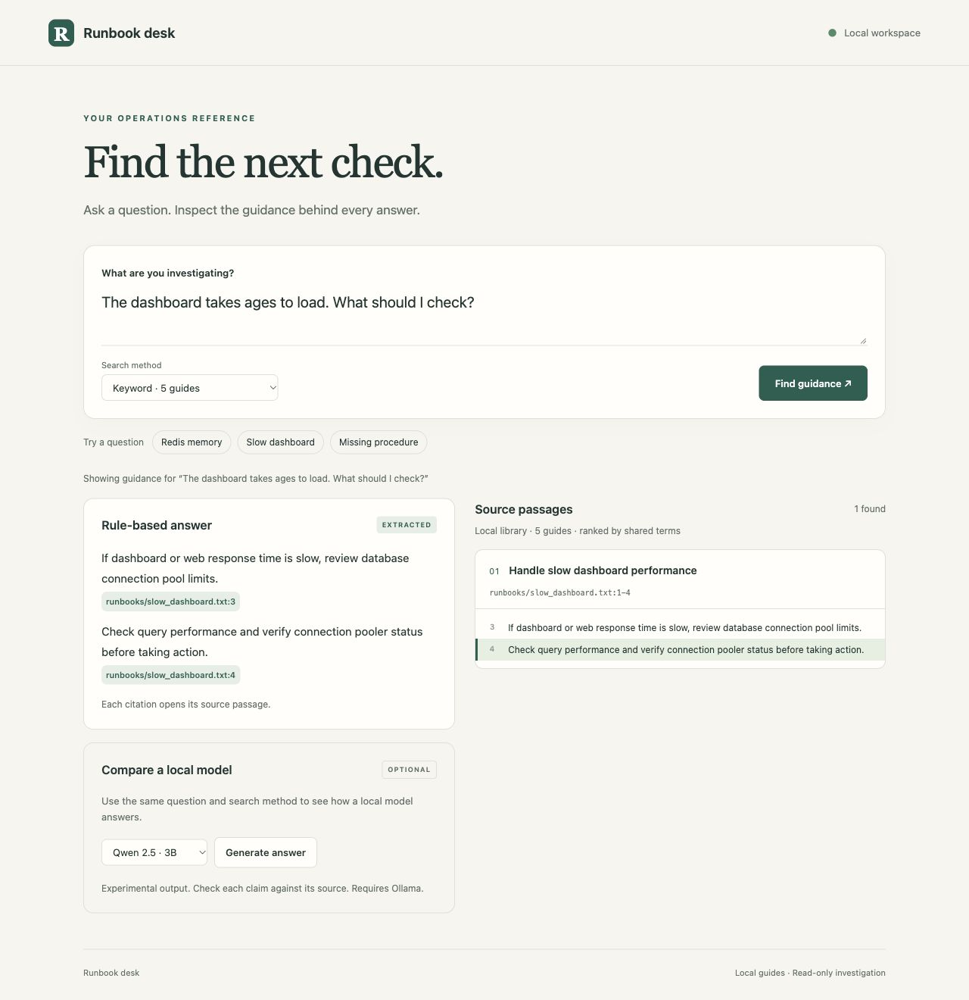
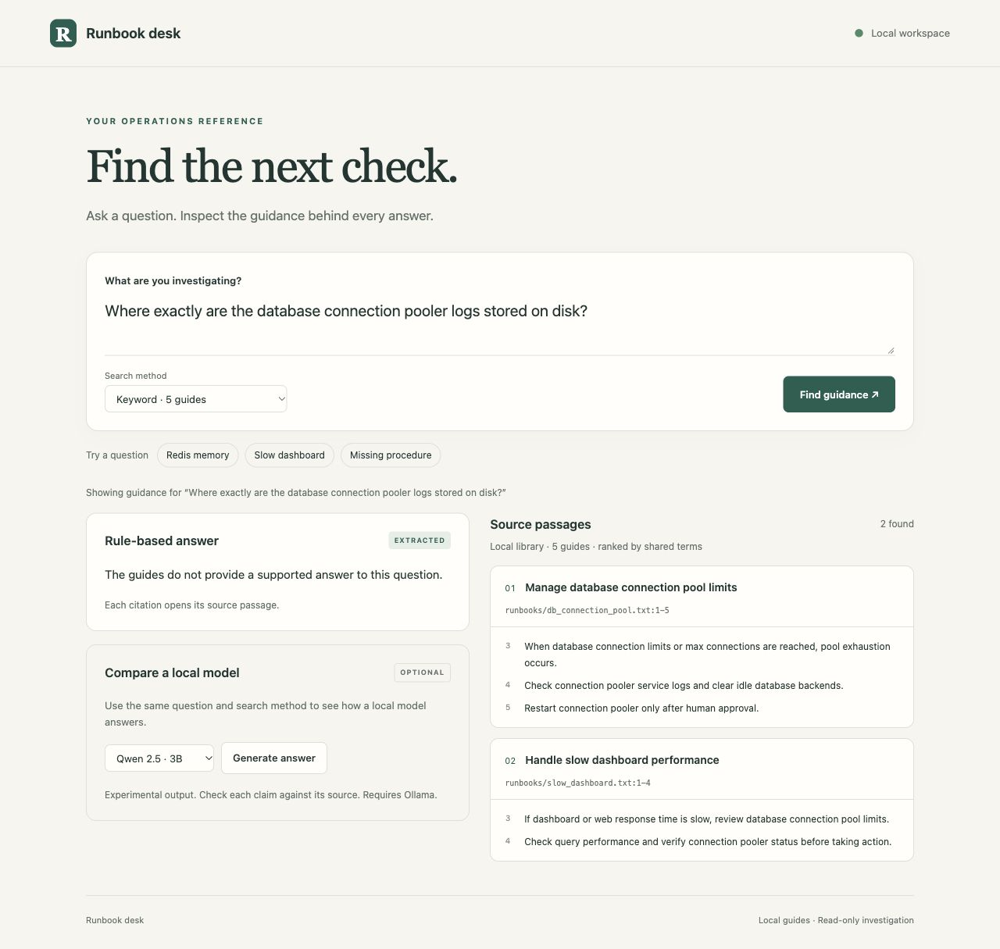
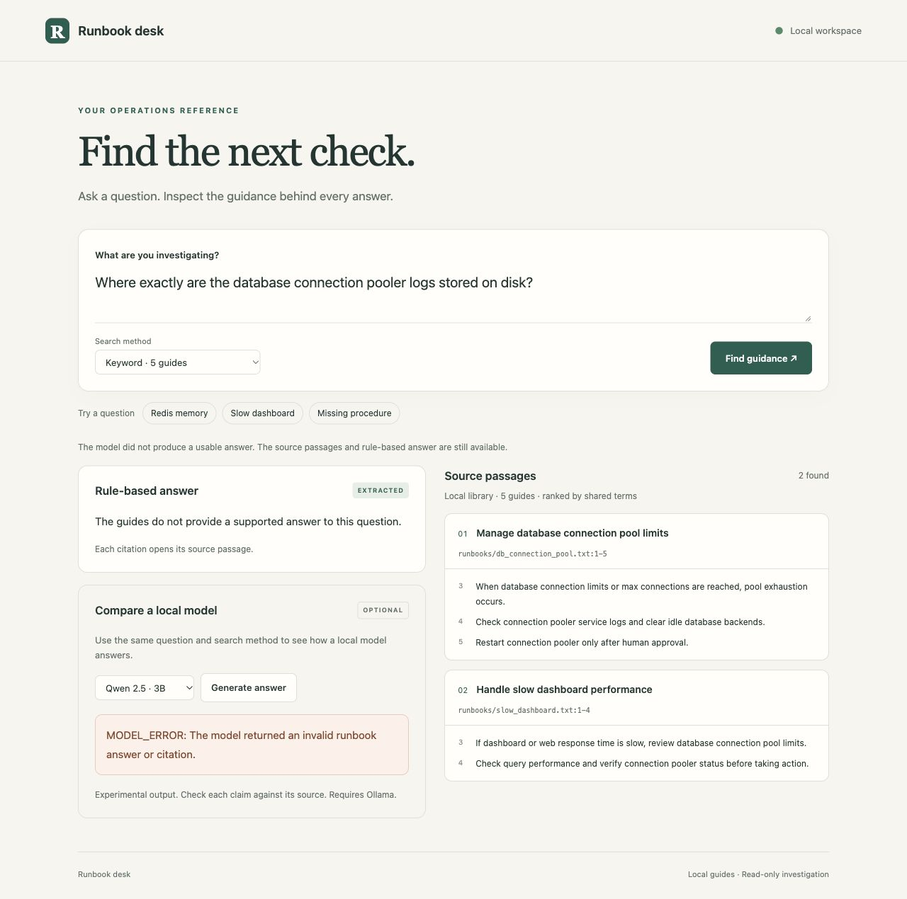

# Runbook desk walkthrough

A short demonstration of cited guidance, missing information, and local
model comparison. Start from the repository:

```sh
python runbook_ui.py
```

Open http://127.0.0.1:8765. Use Keyword search for this walkthrough.
No cloud API key is needed.

[View the 28-second visual walkthrough](images/runbook-desk-walkthrough.mp4).
It is assembled from screenshots of the observed browser states. It has no
audio and does not show continuous screen activity.

## 1. Ask a supported question

Enter: The dashboard takes ages to load. What should I check?

The rule-based answer should include connection pool limits, query
performance, and pooler status. The dashboard guide should appear alongside.

Click the citation ending in slow_dashboard.txt:4. The source line should
highlight, showing exactly where the answer came from.



## 2. Ask for a missing detail

Enter: Where exactly are the database connection pooler logs stored on disk?

The database guide can rank first because it discusses pooler logs.
It gives no filesystem path. The rule-based answer should say the guides
do not provide a supported answer. A topic match is not enough to answer
the specific question.



## 3. Compare a local model

Select an installed Qwen model and click Generate answer.

Read its answer against the source lines. It should identify the missing
path and avoid inventing one. If output fails validation, the page reports
that the model did not produce a usable answer and retains the evidence.

This is an experimental answer mode. The existing evaluations found
incomplete answers, unsupported claims, and rejected responses. A valid
citation ID alone does not establish that the source supports a claim.

In the captured run, Qwen 3B returned an invalid answer or citation.
The page displayed the error and kept the rules and passages visible.



## Narration

The assistant finds relevant guides and shows the evidence beside its
answer. The dashboard example has explicit checks to cite. The database
example has related material but lacks the requested path, so the rules
withhold an answer. The optional model comparison makes its successes
and mistakes visible against the same kind of source evidence.

## Evaluation

Use the saved-response command without calling a model:

```sh
python runbook_model_eval.py --replay results/qwen7b-comparison-responses.json --reviews results/qwen7b-comparison-reviews.json
```

The preserved 7B review scores 0/8 complete answers, 6/12 grounded
responses, and 4/4 missing-detail cases handled. These are proposed
reviewer judgments on the recorded run. See RUNBOOK_EVALUATION.md for
the rubric and review process.
